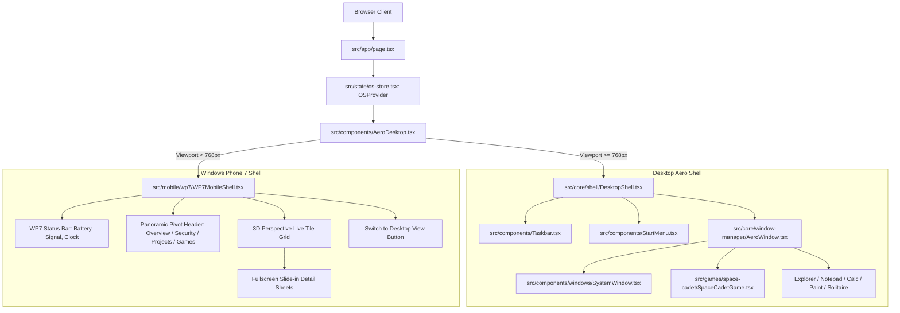

# Windows 7 Portfolio: Direct Desktop Landing, Windows Phone 7 Aero Mobile Shell, & Space Cadet Pinball

*   **Author:** Mohamed Elsheikh
*   **Status:** Draft
*   **Date:** 2026-10-31

--------------------------------------------------------------------------------

## Overview

A dual-tier web operating system portfolio that eliminates recruiter bounce rate on desktop while introducing an authentic Windows Phone 7 Aero Glass mobile experience. On desktop viewports (>=768px), visitors land directly onto the Windows 7 Aero desktop with a single centered Executive Overview window open, bypassing the boot and login delay. On mobile screens (<768px), the interface pivots to a Windows Phone 7 live tile layout styled with Aero Glass acrylic translucency, 3D tilt micro-interactions, and horizontal panoramic navigation. The entertainment suite adds an authentic Windows-era 3D Space Cadet Pinball game built with vector SVG cabinet chrome and canvas physics.

## The Problem

1. **Recruiter Bounce Rate**: Technical recruiters and engineering leaders spend 30–60 seconds evaluating a candidate portfolio. A mandatory 10-second boot sequence and login screen creates immediate friction, causing high bounce rates before key cybersecurity credentials and experience are seen.
2. **Mobile Usability Breakdown**: Real Windows 7 desktop window chrome (16px buttons, draggable titlebars, resize handles) is difficult to operate on 390px mobile screens. Over 50% of inbound portfolio traffic arrives from mobile devices (e.g., LinkedIn links).
3. **Multi-Window Overlap Clutter**: The desktop currently opens both Portfolio Explorer and System Properties simultaneously, forcing visitors to manage overlapping windows before reading candidate qualifications.

## Goals

*   **Sub-Second Time to Content**: Desktop visitors reach the interactive desktop and candidate summary in under 300ms by defaulting `sessionPhase` to `'desktop'`.
*   **Unified Executive Overview**: Display a single centered Executive Summary window on load featuring 4 direct call-to-actions: Download Resume (.pdf/.txt), Contact Mohamed (WhatsApp/Email), Verify Security Credentials (15+), and Browse Featured Projects (6).
*   **Windows Phone 7 Aero Mobile Shell**: Deliver a dedicated touch-first interface for screens <768px with 3D tilt tiles, panoramic horizontal category pivot (`Overview | Security | Projects | Games`), and a desktop mode toggle.
*   **Space Cadet Pinball Integration**: Add 3D Pinball: Space Cadet under `src/games/space-cadet/` adhering to `AppModuleContract` with flipper controls, bumper scoring, and audio cues.
*   **Replay Capabilities**: Retain the boot sequence and logon screen as interactive features accessible via the Start Menu, context menus, and a `?boot=1` URL query parameter.

## Non-Goals

*   **General-Purpose Mobile OS**: The WP7 interface focuses strictly on presenting portfolio content and games, not simulating mobile settings or cellular configurations.
*   **Heavy 3D Physics Engines**: Avoid bundling external 3D physics libraries (Three.js/Ammo) to protect bundle size and load speed; use 2D canvas physics and vector SVG assets.
*   **Backend Server State**: Retain all virtual file and high score persistence in browser local storage without adding external server dependencies.

## Open Questions

*   **Question 1**: Should Space Cadet Pinball include on-screen touch buttons for mobile play, or should pinball remain desktop-only with a mobile launch notice?
*   **Question 2**: For the resume download button, should the site package both a pre-rendered PDF and the virtual `.txt` file, or generate the PDF dynamically?

## Critical User Journeys (CUJs)

### CUJ 1: Desktop Recruiter Quick Scan

*   **Given**: A recruiter lands on the site from a desktop browser.
*   **When**: The page loads.
*   **Then**: The desktop appears immediately with the Harmony wallpaper, taskbar, and a centered Executive Overview window. The recruiter clicks "Download Resume" or "Verify Certifications" without managing window positions.

### CUJ 2: Mobile Visitor Navigation

*   **Given**: A visitor opens the portfolio link on a mobile device (<768px).
*   **When**: The site mounts.
*   **Then**: The Windows Phone 7 Aero Glass tile interface renders. The user scrolls through live tiles or swipes horizontally across panoramic categories (Overview, Security, Projects, Games) with 64px+ touch targets.

### CUJ 3: Nostalgia Replay & Space Cadet

*   **Given**: A visitor wants to experience the original Windows 7 boot or play Space Cadet.
*   **When**: The user clicks the Start Menu and selects "Restart Windows 7" or launches "Space Cadet Pinball".
*   **Then**: The system replays the 4-orb swirling boot sequence or launches the pinball window with functioning flippers, bumpers, and sound effects.

--------------------------------------------------------------------------------

## Technical Plan (Architecture)

### 1. Architectural Topology & Component Flow

The application branches between the full desktop operating system shell and the Windows Phone 7 mobile shell based on client viewport width, mediated by an SSR-safe hook. Both environments share the single underlying `useOS()` store.

### 2. Desktop Direct Landing & Session Phase Refactor

1. **State Default**: Modify `src/state/os-store.tsx:412` so `sessionPhase` initializes to `'desktop'`.
2. **URL Parameter Bypass**: In `OSProvider`, check `window.location.search` on mount. If `?boot=1` is present, initialize `sessionPhase` to `'booting'`.
3. **Window Initialization**: Update `INITIAL_MANAGED_WINDOWS` in `src/state/os-store.tsx`:
   - `system` (Executive Overview): `isOpen: true`, positioned centered at `{ x: 260, y: 35, width: 840, height: 570 }`, `zIndex: 30`.
   - `explorer` (File Explorer): `isOpen: false`, positioned at default coordinates, available via desktop icon or Start Menu.
   - All other accessory windows (`notepad`, `calculator`, `paint`, `cmd`, `security`, games): `isOpen: false`.

### 3. Executive Overview Window Enhancement

Update `src/components/windows/SystemWindow.tsx` to provide immediate, high-priority recruiter touchpoints:
- **Direct Action Bar**: Prominently position 4 high-contrast buttons directly below the executive identity card:
  1. *Download Resume* (`.pdf` / `.txt` split dropdown or download trigger).
  2. *Contact Mohamed* (direct WhatsApp API link and modal email composer).
  3. *Verify Credentials* (opens Security Center with 15+ external Credly/Coursera links).
  4. *Browse Projects* (opens File Explorer directly at the Projects library).
- **Security Leadership & CVE Callouts**: Highlight Mohamed's active roles (Qodex CEO, Quota Libex Security Lead) and research accomplishments directly in the main system specifications grid.

### 4. Windows Phone 7 Aero Mobile Shell (`src/mobile/wp7/`)

A dedicated mobile subsystem optimized for thumb navigation and portrait screens:
1. **Viewport Detection (`src/hooks/useViewport.ts`)**:
   - Custom hook returning `{ isMobile: boolean, width: number, toggleMode: () => void, forcedMode: 'desktop' | 'mobile' | null }`.
   - Uses `window.matchMedia('(max-width: 767px)')` on client mount, defaulting gracefully during SSR to prevent hydration mismatches.
2. **Panoramic Pivot Layout (`WP7MobileShell.tsx`)**:
   - Top status bar: 100% vector SVG icons for cellular signal, Wi-Fi, battery, and live digital clock.
   - Large Metro-style category headers: `mohamed elsheikh // overview | security | projects | games | contact`.
   - Horizontal touch swipe gestures with CSS scroll-snap or lightweight GSAP horizontal drag physics.
3. **Aero Live Tiles (`WP7Tile.tsx`)**:
   - Standard 2x2 square and 2x1 wide live tiles.
   - Visual styling: Aero Glass acrylic tint (`backdrop-filter: blur(16px)`), subtle translucent white border (`rgba(255,255,255,0.3)`), and drop shadows.
   - Micro-interaction: Authentic WP7 3D tilt on pointer touch using CSS `transform: perspective(600px) rotateX(...) rotateY(...) scale(0.97)` calculated from tap coordinate offsets.
   - Content:
     - *Resume & Bio Tile*: Live avatar, name, and instant download button.
     - *Security Center Tile*: Live counter "15 Verified Credentials (AWS, Microsoft, Google)".
     - *Projects Tile*: Scrolling list of 6 featured projects.
     - *Games Tile*: Launch buttons for Space Cadet, Solitaire, and Minesweeper.
     - *Direct Contact Tile*: One-tap WhatsApp, LinkedIn, GitHub, and phone dialer.

### 5. 3D Space Cadet Pinball Integration (`src/games/space-cadet/`)

1. **Module Contract (`spaceCadetModule`)**:
   - Implements `AppModuleContract` defined in `src/apps/types.ts`.
   - Window defaults: `{ id: 'space-cadet', title: '3D Pinball for Windows - Space Cadet', shortLabel: 'Space Cadet', defaultPos: { x: 260, y: 30, width: 620, height: 620 } }`.
2. **Game Architecture (`SpaceCadetGame.tsx`)**:
   - Canvas-based 2D physics engine simulating pinball dynamics (gravity, ball acceleration, bumper elastic bounce, flipper rotational impulses).
   - Controls: Left Flipper (`Z` or `Left Arrow`), Right Flipper (`/` or `Right Arrow`), Plunger (`Space` or `Down Arrow`), Table Tilt (`X` or `C`).
   - Scoring & Missions: Authentic Space Cadet mission progression (Cadet rank advancement, hyperspace ramp bonuses, wormhole targets, flag hits).
   - Audio: Synthetic Web Audio API sounds for flipper solenoids, bumper hits, and launch clicks via `aeroSound`.
   - Vector Frame: Scalable vector SVG cabinet trim, score LCD display, and field overlays.

--------------------------------------------------------------------------------

## Alternatives Considered

### Alternative 1: Mandatory Boot & Logon Sequence on Initial Load

*   **Pros**: Maximizes immersion and shows off the SVG light trail animations immediately to all visitors.
*   **Cons**: Adds 8–12 seconds of delay before showing any credentials or resume information, driving high bounce rates among technical recruiters.
*   **Reason for Rejection**: Recruiter time is extremely scarce (30–60s total evaluation window). Forcing a 10-second non-skippable ritual directly harms job search conversion. Preserving boot as a replayable feature via the Start Menu achieves the nostalgic goal without imposing friction on busy hiring teams.

### Alternative 2: Responsive CSS Downscaling of Desktop Windows for Mobile

*   **Pros**: Single unified desktop shell codebase; no secondary mobile interface required.
*   **Cons**: Window management chrome (16px buttons, dragging title bars, corner resizers) breaks down on 390px screens, causing touch target frustration and overlapping windows.
*   **Reason for Rejection**: Squeezing a mouse-driven desktop operating system onto mobile phones produces poor usability for over 50% of inbound traffic. Windows Phone 7's Metro tile interface was specifically designed for touch thumb zones while naturally extending the Microsoft operating system lineage.

### Alternative 3: Generic Web Mobile Layout (Standard Responsive Cards)

*   **Pros**: Standard, familiar web interaction patterns.
*   **Cons**: Breaks thematic continuity and discards the user's explicit love for Windows operating system aesthetics.
*   **Reason for Rejection**: The Windows Phone 7 Aero Glass hybrid delivers thumb-first touch ergonomics while maintaining authentic Windows nostalgia through live tiles, 3D perspective tilt, and glass translucency.

### Alternative 4: Full 3D Physics Engine (Three.js + Ammo.js) for Space Cadet Pinball

*   **Pros**: Full 3D polygon meshes and complex physical collision simulation.
*   **Cons**: Introduces >1.5MB of additional JavaScript bundle weight, slower initial asset downloads, and battery drain on mobile devices and low-spec laptops.
*   **Reason for Rejection**: Unjustified complexity. A 2D HTML5 canvas physics model combined with vector SVG cabinet artwork delivers 60fps performance and instantaneous load times while remaining 100% true to the original game's visual presentation.

--------------------------------------------------------------------------------

## Non-Functional Requirements

### Security & Privacy
*   Client-side architecture with zero external third-party API dependencies for core functionality.
*   Direct contact forms link directly to verified WhatsApp API and standard `mailto:` handlers without storing user messages on unverified third-party intermediate backends.
*   Local storage keys (`w7_minesweeper_scores`, `theme`) are strictly scoped and sanitized.

### Performance & Latency
*   Initial page load Time to Interactive (TTI) under 500ms on desktop broadband connections.
*   Pinball game assets lazy-loaded on window launch using `next/dynamic` with `{ ssr: false }` to prevent bloating the main landing bundle.
*   All visual assets remain 100% vector SVG geometry with scoped unique gradient IDs to prevent DOM namespace collisions.

### Rollout & Backward Compatibility
*   Direct fallback to desktop view on mobile devices via a persistent "Switch to Desktop Mode" button.
*   Full `prefers-reduced-motion` compliance across all GSAP transitions, WP7 tile tilt animations, and canvas physics loops.

--------------------------------------------------------------------------------

## Detailed Implementation Plan

The implementation is executed as a unified sequence across 15 target files without cross-module regressions.

### Target Files to Create / Modify

#### 1. `src/state/os-store.tsx` (Modify)
*   **Scope**: Global state machine defaults and URL query parameters.
*   **Rationale**: 
    1. Initialize `sessionPhase` to `'desktop'` so first-time visitors reach content without delay.
    2. Add `useEffect` checking `window.location.search` for `?boot=1` to support explicit replay.
    3. Update `INITIAL_MANAGED_WINDOWS` to make `system` the sole open window (`isOpen: true`) centered at `{ x: 260, y: 35, width: 840, height: 570 }`, setting `explorer.isOpen = false`.
    4. Register `space-cadet` in the managed window registry with initial coordinates `{ x: 260, y: 30, width: 620, height: 620 }`.

#### 2. `src/components/windows/SystemWindow.tsx` (Modify)
*   **Scope**: Executive Overview window presentation and CTAs.
*   **Rationale**:
    1. Add a prominent high-contrast action bar with direct links: Download Resume (`Resume_Mohamed_Elsheikh.txt` / PDF), Contact via WhatsApp / Email, Verify 15+ Credentials, and Browse Featured Projects.
    2. Add executive callouts for cybersecurity achievements (CVE research, Qodex CEO, Quota Libex Security Lead, zero-trust architecture).

#### 3. `src/hooks/useViewport.ts` (Create)
*   **Scope**: SSR-safe responsive viewport detection hook.
*   **Rationale**:
    1. Tracks client window width using `window.matchMedia('(max-width: 767px)')`.
    2. Maintains `forcedMode: 'desktop' | 'mobile' | null` state allowing users to manually toggle between shells on mobile or tablet screens.
    3. Prevents React hydration mismatch errors by defaulting safely until mounted.

#### 4. `src/mobile/wp7/WP7MobileShell.tsx` (Create)
*   **Scope**: Windows Phone 7 mobile shell environment.
*   **Rationale**:
    1. Renders a mobile status bar (cellular signal bars, Wi-Fi icon, battery level, live digital clock).
    2. Provides a panoramic pivot header (`OVERVIEW | SECURITY | PROJECTS | GAMES | CONTACT`) with horizontal touch swipe transitions.
    3. Hosts the 3D tilt live tile grid reading directly from `useOS()` store.
    4. Includes a persistent bottom app bar with "Switch to Desktop Mode" toggle.

#### 5. `src/mobile/wp7/WP7Tile.tsx` (Create)
*   **Scope**: Interactive Metro live tile component with Aero Glass styling.
*   **Rationale**:
    1. Applies authentic WP7 3D tilt micro-interactions on pointerdown calculated from tap coordinates (`transform: perspective(600px) rotateX(...) rotateY(...) scale(0.97)`).
    2. Styles tiles with Aero Glass blur (`backdrop-filter: blur(16px)`), specular white borders, and drop shadows.
    3. Supports square (2x2) and wide (2x1) layout sizes.

#### 6. `src/mobile/wp7/WP7DetailModal.tsx` (Create)
*   **Scope**: Mobile detail view sheet.
*   **Rationale**:
    1. Provides slide-in full-screen reader sheets for viewing projects, credential badges, and contact forms when a tile is tapped on mobile.

#### 7. `src/games/space-cadet/SpaceCadetGame.tsx` (Create)
*   **Scope**: 3D Pinball: Space Cadet simulation engine.
*   **Rationale**:
    1. Implements HTML5 2D canvas physics loop modeling gravity, ball velocity, bumper elastic impulse, and flipper rotation.
    2. Supports keyboard controls (`Z` / `Left Arrow`, `/` / `Right Arrow`, `Space` plunger) and on-screen touch buttons for mobile play.
    3. Renders vector SVG cabinet chrome, ball, bumper lights, and authentic Space Cadet field graphics.

#### 8. `src/games/space-cadet/index.tsx` (Create)
*   **Scope**: Application module contract adapter for Space Cadet.
*   **Rationale**:
    1. Exports `spaceCadetModule` conforming to `AppModuleContract` with window geometry, metadata, lifecycle callbacks, and component binding.

#### 9. `src/core/assets/index.tsx` (Modify)
*   **Scope**: Shared vector SVG asset library.
*   **Rationale**:
    1. Adds `SpaceCadetIcon` for desktop shortcuts, Start Menu, taskbar badges, and mobile tiles.
    2. Adds mobile status bar glyphs (`SignalIcon`, `WifiIcon`, `BatteryIcon`).

#### 10. `src/apps/registry.tsx` (Modify)
*   **Scope**: Application registry index.
*   **Rationale**:
    1. Imports and registers `spaceCadetModule` in `APP_REGISTRY`.

#### 11. `src/components/AeroDesktop.tsx` (Modify)
*   **Scope**: Root operating system shell orchestrator.
*   **Rationale**:
    1. Consumes `useViewport()` to branch between `<DesktopShell />` and `<WP7MobileShell />`.
    2. Connects manual desktop mode toggle callback.

#### 12. `src/components/Taskbar.tsx` (Modify)
*   **Scope**: Superbar taskbar icon registry.
*   **Rationale**:
    1. Adds `space-cadet` icon to `TASKBAR_ICONS` map.

#### 13. `src/components/StartMenu.tsx` (Modify)
*   **Scope**: Start Menu program listings.
*   **Rationale**:
    1. Adds Space Cadet Pinball to pinned programs and the `All Programs -> Games` list.

#### 14. `src/components/AeroSound.ts` (Modify)
*   **Scope**: Web Audio procedural sound synthesizer.
*   **Rationale**:
    1. Adds procedural audio generators for Space Cadet pinball: flipper solenoid click, bumper bounce tone, plunger launch release, and tilt alarm.

#### 15. `src/games/space-cadet/README.md` & `src/games/README.md` (Create / Modify)
*   **Scope**: EGM architecture documentation contracts.
*   **Rationale**:
    1. Creates `src/games/space-cadet/README.md` documenting interface, invariants, and side effects.
    2. Updates `src/games/README.md` to register the new game child contract.
