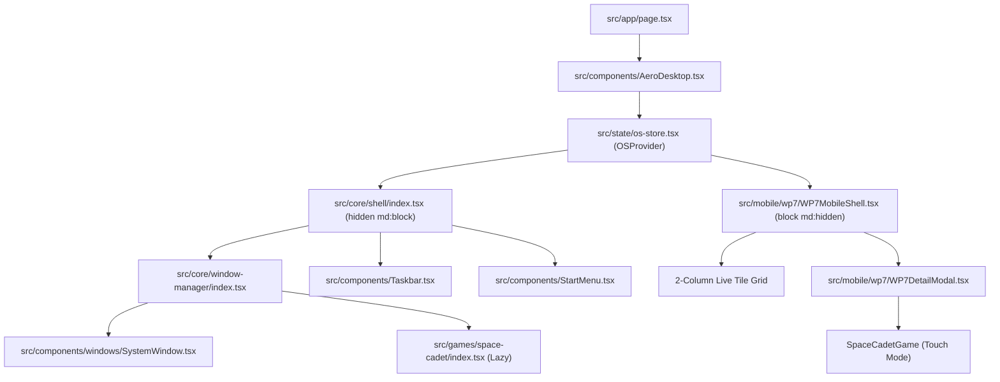

# Technical Design: Windows 7 Portfolio Desktop Optimization, WP7 Mobile Experience & Space Cadet Pinball

*   **Author**: Mohamed Elsheikh
*   **Status**: Approved (Reviewed & Remediated)
*   **Created**: 2026-10-31
*   **Updated**: 2026-10-31
*   **Sitemap Registration**: [`docs/designs/SITEMAP.md`](file:///c:/Users/modded/Documents/GitHub/portflio/docs/designs/SITEMAP.md)

--------------------------------------------------------------------------------

## Overview

This specification details architectural adjustments and feature additions to the Windows 7 portfolio simulation web operating system. The update introduces direct desktop landing to reduce initial bounce friction, adds a responsive Windows Phone 7 (WP7) Aero Glass shell for viewports under 768px, and introduces an arcade Space Cadet 2D canvas pinball game registered across desktop and mobile application registries.

--------------------------------------------------------------------------------

## The Problem

1.  **Recruiter Landing Friction**: First-time visitors previously encountered a 10-second boot animation and logon screen sequence before accessing portfolio content, creating high bounce rates during rapid recruiter evaluations.
2.  **Overlapping Window Default**: Both Portfolio Explorer and System Properties previously opened simultaneously upon desktop mount, producing visual clutter.
3.  **Mobile Viewport Incompatibility**: Desktop window management (drag headers, resize borders, 16px titlebar icons) is ill-suited for narrow mobile touch screens (390px width), where touch targets violate the 48px accessibility minimum.

--------------------------------------------------------------------------------

## Goals

*   **Direct Desktop Landing**: Default visitor sessions directly to the Windows 7 desktop with a single centered Executive Overview window open.
*   **Instantaneous Accessibility**: Preserve the boot sequence and logon screen strictly as explicit, on-demand experiences (e.g. via Start Menu -> "Restart Windows 7" or `?boot=1` URL parameter).
*   **WP7 Mobile Shell**: Provide a dedicated mobile layout on viewports `<768px` modeled after the Windows Phone 7 Start Screen with 2-column live tiles, 3D perspective tilt transforms, and full-screen detail sheets.
*   **Space Cadet Arcade Pinball**: Deliver a lightweight 2D canvas pinball game with accurate table geometry, flipper impulse physics, bumper recoil, procedural audio, and SVG cabinet chrome.
*   **Zero Hydration Layout Shift (CLS)**: Prevent layout shifts between desktop and mobile shells using responsive CSS display rules.

--------------------------------------------------------------------------------

## Non-Goals

*   **No Multi-Tier Pinball Missions**: Speculative features such as military rank promotions, multi-ball ramps, and wormhole state machines are excluded; the game focuses strictly on arcade table scoring.
*   **No Redundant Mobile Pivot**: Horizontal panoramic swipe navigation is excluded in favor of the vertical WP7 Start Screen tile grid to prevent gesture contention.
*   **No Monolithic Viewport Hydration Wrappers**: JavaScript-dependent device detection for initial layout is rejected in favor of CSS media queries.
*   **No Video/GIF Assets**: All UI decorations, icons, and chrome remain 100% vector SVG.

--------------------------------------------------------------------------------

## Open Questions

*   *Resolved*: Direct desktop landing is completely silent; Web Audio initialization is deferred until the first explicit user interaction to comply with browser autoplay policies.
*   *Resolved*: Space Cadet on mobile viewports mounts inside a full-screen WP7 detail modal sheet with on-screen touch flipper controls.

--------------------------------------------------------------------------------

## Critical User Journeys (CUJs)

### CUJ 1: Inbound Recruiter Rapid Evaluation (Desktop)
1.  **Action**: Recruiter navigates to portfolio root URL.
2.  **System Response**: Desktop immediately appears without boot or logon animation.
3.  **System Response**: Executive Overview window is centered on screen displaying core profile, contact links (Resume download, WhatsApp, Email), cybersecurity credentials, and featured projects.
4.  **Action**: Recruiter clicks "Download Resume" or "WhatsApp". Action completes in under 2 seconds.

### CUJ 2: Mobile Visitor Navigation (Smartphone `<768px`)
1.  **Action**: Visitor opens portfolio on smartphone viewport (390x844).
2.  **System Response**: The WP7 Start Screen renders with zero CLS layout shift via responsive CSS.
3.  **System Response**: Two-column live tile grid displays hubs: Overview, Security, Projects, Games, and Contact.
4.  **Action**: Visitor taps "Projects" tile. Tile executes a 3D perspective tilt on pointerdown, and a full-screen detail sheet slides into view with 48px+ touch targets.
5.  **Action**: Visitor taps "Switch to Desktop Mode". Viewport toggles to the desktop interface.

### CUJ 3: Nostalgia Replay & Space Cadet Pinball
1.  **Action**: Visitor launches "Space Cadet" from desktop shortcut, Start Menu, or mobile Games tile.
2.  **System Response**: Pinball game lazy-loads via `next/dynamic` and mounts.
3.  **Action**: User launches ball with Spacebar and operates flippers with `Z` and `/` keys (or touch buttons on mobile).
4.  **System Response**: Ball dynamics, bumper recoil, flipper collisions, and procedural audio effects execute smoothly at 60fps.

--------------------------------------------------------------------------------

## Technical Plan (Architecture)

### 1. Architectural Topology & Component Flow



### 2. State Machine & Query Parameter Routing (`src/state/os-store.tsx`)

*   **Default Session Phase**: Initialize `sessionPhase` to `'desktop'` in initial state so SSR and client mount agree on direct desktop rendering.
*   **Explicit Replay Query Parameter**: Inspect `window.location.search` for `?boot=1` during client mount. If present, transition `sessionPhase` to `'booting'`.
*   **Managed Window Registry**: Configure `INITIAL_MANAGED_WINDOWS` so `system` is the sole initially open window (`isOpen: true`, `isMinimized: false`) centered at `{ x: 260, y: 35, width: 840, height: 570 }`, with `explorer.isOpen = false`.
*   **Register Space Cadet Window**:
    ```ts
    {
      id: 'space-cadet',
      title: '3D Pinball for Windows - Space Cadet',
      shortLabel: 'Space Cadet',
      glowColor: 'rgba(168, 85, 247, 0.65)',
      isOpen: false,
      isMinimized: false,
      zIndex: 25,
      snap: 'none',
      defaultPos: { x: 260, y: 30, width: 620, height: 620 },
      pinned: true,
    }
    ```

### 3. Executive Overview Action Bar (`src/components/windows/SystemWindow.tsx`)

*   Add a prominent action bar at the top of the System Overview window with direct execution handlers:
    1.  **Download Resume**: Dynamically generates and downloads an in-memory `Resume_Mohamed_Elsheikh.txt` Blob, with an option to open the document inside the Notepad window (`onOpenWindow('notepad')`).
    2.  **WhatsApp Quick Chat**: Direct link to `window.open('https://wa.me/201021464357', '_blank')`.
    3.  **View Cybersecurity Credentials**: Dispatches `onOpenWindow('security')`.
    4.  **Browse Featured Projects**: Dispatches `onOpenExplorerSection('projects')`.

### 4. Windows Phone 7 Aero Mobile Shell (`src/mobile/wp7/`)

*   **Responsive Display Gating**: The mobile shell container uses CSS classes `block md:hidden`, and the desktop shell uses `hidden md:block`, ensuring zero CLS layout shift during initial load.
*   **Viewport Override State**: [`src/hooks/useViewport.ts`](file:///c:/Users/modded/Documents/GitHub/portflio/src/hooks/useViewport.ts) exposes `forcedMode: 'desktop' | 'mobile' | null`, allowing visitors to manually switch between desktop and mobile layouts.
*   **Start Screen Layout**: Vertical scrollable 2-column grid of live tiles (`WP7Tile.tsx`) themed with Aero Glass gradients, blue accents, and 3D perspective tilt transforms:
    *   `rotateX = ((touchY - centerY) / height) * -20deg`
    *   `rotateY = ((touchX - centerX) / width) * 20deg`
*   **Core Hubs**:
    1.  *Overview*: Profile summary, bio, and resume download.
    2.  *Security*: 15+ cybersecurity certifications with credential IDs and verification URLs.
    3.  *Projects*: Featured project portfolio cards.
    4.  *Games*: Space Cadet, Minesweeper, and Solitaire launch hub.
    5.  *Contact*: Email and WhatsApp quick-action tile.
*   **Full-Screen Detail Modal (`WP7DetailModal.tsx`)**: Slide-in sheet displaying hub content with 48px+ touch targets and a persistent back navigation app bar.

### 5. Space Cadet Arcade Pinball (`src/games/space-cadet/`)

*   **Canvas Simulation (`SpaceCadetGame.tsx`)**:
    *   Coordinate space: `width: 600px`, `height: 800px`.
    *   Physics constants: `GRAVITY = 0.22`, `BALL_RADIUS = 7`, `BOUNCE_RESTITUTION = 1.35`, `MAX_VELOCITY = 18`.
    *   Flippers: Left flipper pivot at `(210, 720)`, Right flipper pivot at `(390, 720)`, length `70px`, rest angle `30°`, active angle `-25°`.
    *   Bumpers: 3 circular bumpers at `(250, 240)`, `(350, 240)`, and `(300, 310)` with radius `28px` imparting velocity impulse of `8.5px/frame` and `500` points per hit.
    *   Slingshots: Left slingshot at `(160, 600)`, Right slingshot at `(440, 600)` with `100` points per hit.
    *   Controls: Left flipper (`Z` / left button / left screen touch), Right flipper (`/` / right button / right screen touch), Plunger launch (`Spacebar` / touch button).
*   **Lifecycle & Power Optimization**:
    *   Cancel `requestAnimationFrame` loop when `document.hidden` is true or `ManagedWindowState.isMinimized` is true.
    *   Web Audio generators for flipper solenoids, bumper tones, and plunger release initialized strictly upon first user pointerdown.
*   **Module Registration**: [`src/games/space-cadet/index.tsx`](file:///c:/Users/modded/Documents/GitHub/portflio/src/games/space-cadet/index.tsx) wraps the component via `next/dynamic` with `{ ssr: false }` and implements `AppModuleContract`.

--------------------------------------------------------------------------------

## Alternatives Considered

*   **Three.js / Ammo.js 3D Physics Engine**: Rejected due to 450KB+ bundle weight, battery drain on mobile devices, and high implementation complexity. A 2D HTML5 canvas simulation with vector SVG cabinet chrome achieves the target visual nostalgia at <25KB bundle footprint.
*   **Pure Downscaled Desktop Windows on Mobile**: Rejected because 16px desktop controls and draggable windows violate mobile accessibility standards and frustrate touch interactions.
*   **Client-Side JavaScript Viewport Branching**: Rejected due to Cumulative Layout Shift (CLS) during React hydration. Replaced with responsive CSS media query rules (`hidden md:block` / `block md:hidden`).

--------------------------------------------------------------------------------

## Non-Functional Requirements

*   **Performance**: First Contentful Paint < 350ms; Time to Interactive < 500ms on desktop direct landing. Canvas physics loop maintains stable 60fps.
*   **Bundle Budget**: Net new code < 35KB gzipped. Space Cadet lazy-loaded on demand.
*   **Accessibility**: Minimum 48px touch targets across WP7 mobile shell. Full keyboard control support for desktop windows and games.
*   **Browser Compatibility**: Full functional parity across modern Chromium, Firefox, WebKit (Safari), and mobile WebKit.

--------------------------------------------------------------------------------

## Risks & Mitigations

| Risk / Failure Mode | Severity | Impact | Mitigation Strategy |
| --- | --- | --- | --- |
| **Mobile Web Audio Autoplay Policy** | High | Audio calls throw errors or fail silently on mobile browsers. | Defer `AudioContext` creation until the first pointerdown or keydown event. Provide silent fallback if context fails to start. |
| **SSR Hydration Layout Shift (CLS)** | High | Flash of desktop shell on mobile viewports during initial load. | Use responsive CSS display rules (`hidden md:block` and `block md:hidden`) on shell containers to ensure zero layout shift before and after hydration. |
| **Canvas Loop Battery Drain** | Medium | Continuous physics loop drains mobile battery and heats device. | Automatically cancel `requestAnimationFrame` on `document.hidden` and window minimization events; resume on active focus. |
| **Shell Unmount State Loss** | Medium | Screen rotation across 768px unmounts shells, losing modal state. | Maintain global window state in `OSProvider` above both shells; bind shell mode changes to manual toggle and viewport thresholds. |

--------------------------------------------------------------------------------

## Detailed Implementation Plan

The implementation is structured into 5 sequential phases, each concluding with an automated build and verification checkpoint.

### Phase 1: Core State Defaults & Executive Window Enhancement
*   **Target Files**:
    1.  [`src/state/os-store.tsx`](file:///c:/Users/modded/Documents/GitHub/portflio/src/state/os-store.tsx) (Modify)
        *   Default `sessionPhase` to `'desktop'`.
        *   Add client-side `useEffect` checking `window.location.search` for `?boot=1` to support on-demand reboot.
        *   Update `INITIAL_MANAGED_WINDOWS`: `system.isOpen = true`, `explorer.isOpen = false`.
        *   Register `space-cadet` with complete 10-property `ManagedWindowState`:
            ```ts
            {
              id: 'space-cadet',
              title: '3D Pinball for Windows - Space Cadet',
              shortLabel: 'Space Cadet',
              glowColor: 'rgba(168, 85, 247, 0.65)',
              isOpen: false,
              isMinimized: false,
              zIndex: 25,
              snap: 'none',
              defaultPos: { x: 260, y: 30, width: 620, height: 620 },
              pinned: true,
            }
            ```
    2.  [`src/components/windows/SystemWindow.tsx`](file:///c:/Users/modded/Documents/GitHub/portflio/src/components/windows/SystemWindow.tsx) (Modify)
        *   Add prominent action bar with direct links:
            *   Download Resume: generates/downloads text Blob, or calls `onOpenWindow('notepad')`.
            *   WhatsApp: `window.open('https://wa.me/201021464357', '_blank')`.
            *   Credentials: calls `onOpenWindow('security')`.
            *   Projects: calls `onOpenExplorerSection('projects')`.
*   **Checkpoint**: Run `npm run lint`. Verify zero TypeScript or linting regressions.

### Phase 2: Viewport Management & WP7 Mobile Shell
*   **Target Files**:
    3.  [`src/hooks/useViewport.ts`](file:///c:/Users/modded/Documents/GitHub/portflio/src/hooks/useViewport.ts) (Create)
        *   SSR-safe viewport hook with `forcedMode: 'desktop' | 'mobile' | null`.
        *   Initial state defaults safely to `isMobile: false` during SSR to prevent hydration mismatches.
    4.  [`src/mobile/wp7/WP7Tile.tsx`](file:///c:/Users/modded/Documents/GitHub/portflio/src/mobile/wp7/WP7Tile.tsx) (Create)
        *   Live tile component supporting `square` (1x1) and `wide` (2x1) sizes, Aero gradient backgrounds, and pointerdown 3D perspective tilt transforms.
    5.  [`src/mobile/wp7/WP7DetailModal.tsx`](file:///c:/Users/modded/Documents/GitHub/portflio/src/mobile/wp7/WP7DetailModal.tsx) (Create)
        *   Full-screen slide-in modal sheet for hub content with back button header and 48px+ touch targets.
    6.  [`src/mobile/wp7/WP7MobileShell.tsx`](file:///c:/Users/modded/Documents/GitHub/portflio/src/mobile/wp7/WP7MobileShell.tsx) (Create)
        *   Vertical 2-column Start Screen hosting tiles for Overview, Security, Projects, Games, and Contact.
        *   Persistent "Switch to Desktop Mode" button at bottom.
*   **Checkpoint**: Run `npm run lint`. Verify component contracts and prop types.

### Phase 3: Space Cadet Pinball Engine & Procedural Audio
*   **Target Files**:
    7.  [`src/core/assets/index.tsx`](file:///c:/Users/modded/Documents/GitHub/portflio/src/core/assets/index.tsx) (Modify)
        *   Export vector SVG `SpaceCadetIcon` for desktop shortcuts, Start Menu, taskbar badges, and mobile tiles.
    8.  [`src/components/AeroSound.ts`](file:///c:/Users/modded/Documents/GitHub/portflio/src/components/AeroSound.ts) (Modify)
        *   Add procedural pinball audio methods (`playPinballFlipper()`, `playPinballBumper()`, `playPinballPlunger()`, `playPinballTilt()`) with Web Audio oscillator frequencies and gain envelopes.
        *   Ensure audio initialization is deferred until user interaction.
    9.  [`src/games/space-cadet/SpaceCadetGame.tsx`](file:///c:/Users/modded/Documents/GitHub/portflio/src/games/space-cadet/SpaceCadetGame.tsx) (Create)
        *   HTML5 2D canvas pinball simulation (600x800 coordinate space) with gravity, ball velocity, bumper impulses, flippers, on-screen mobile touch flippers, and score display.
        *   Hook into `document.hidden` and window minimize state to pause animation frame loop when inactive.
    10. [`src/games/space-cadet/index.tsx`](file:///c:/Users/modded/Documents/GitHub/portflio/src/games/space-cadet/index.tsx) (Create)
        *   Export `spaceCadetModule` conforming to `AppModuleContract` with `next/dynamic` lazy-loading (`{ ssr: false }`).
*   **Checkpoint**: Run `npm run lint`. Verify canvas math and Web Audio lifecycle.

### Phase 4: Shell Integration & Desktop Shortcuts
*   **Target Files**:
    11. [`src/apps/registry.tsx`](file:///c:/Users/modded/Documents/GitHub/portflio/src/apps/registry.tsx) (Modify)
        *   Register `space-cadet` in application registry.
    12. [`src/core/shell/index.tsx`](file:///c:/Users/modded/Documents/GitHub/portflio/src/core/shell/index.tsx) (Modify)
        *   Register `SpaceCadetIcon` shortcut in `desktopIcons` array.
    13. [`src/components/AeroDesktop.tsx`](file:///c:/Users/modded/Documents/GitHub/portflio/src/components/AeroDesktop.tsx) (Modify)
        *   Host `<OSProvider>` wrapping both `<DesktopShell className="hidden md:block" />` and `<WP7MobileShell className="block md:hidden" />`.
    14. [`src/components/Taskbar.tsx`](file:///c:/Users/modded/Documents/GitHub/portflio/src/components/Taskbar.tsx) (Modify)
        *   Display running taskbar button and glass preview for Space Cadet.
    15. [`src/components/StartMenu.tsx`](file:///c:/Users/modded/Documents/GitHub/portflio/src/components/StartMenu.tsx) (Modify)
        *   Add Space Cadet Pinball under Games list in Start Menu.
*   **Checkpoint**: Run `npm run build`. Verify complete production build succeeds without errors.

### Phase 5: Architecture Contracts & Drift Verification
*   **Target Files**:
    16. [`src/games/space-cadet/README.md`](file:///c:/Users/modded/Documents/GitHub/portflio/src/games/space-cadet/README.md) (Create)
        *   Architecture contract document for the Space Cadet module.
    17. [`src/games/README.md`](file:///c:/Users/modded/Documents/GitHub/portflio/src/games/README.md) (Modify)
        *   Update games directory documentation to catalog Space Cadet alongside Minesweeper, Solitaire, and Hearts.
*   **Checkpoint**: Verify relative links and zero documentation drift.

--------------------------------------------------------------------------------

## Test & Verification Plan

### Automated Unit & Component Tests
1.  **`src/hooks/useViewport.test.ts`**:
    *   *SSR Safety*: Verifies initial state returns `isMobile: false` during SSR without throwing `window` reference errors.
    *   *Media Listener*: Verifies resize events update `isMobile` when passing `768px` threshold.
    *   *Forced Mode*: Verifies manual `toggleMode('desktop')` overrides viewport width.
2.  **`src/state/os-store.test.tsx`**:
    *   *Default Phase*: Asserts `sessionPhase === 'desktop'` on standard mount.
    *   *Replay Flag*: Asserts `?boot=1` query parameter sets `sessionPhase === 'booting'`.
    *   *Initial Windows*: Asserts `system.isOpen === true` and `explorer.isOpen === false`.
    *   *Space Cadet Registration*: Asserts `space-cadet` exists in `managedWindows` with valid default coordinates.
3.  **`src/games/space-cadet/SpaceCadetGame.test.tsx`**:
    *   *Canvas Mount*: Verifies canvas context initialization and 600x800 coordinate scale.
    *   *Controls*: Verifies `Z`, `/`, and `Space` keydown events trigger flipper rotation and ball launch.
    *   *Lifecycle*: Verifies physics loop halts on window minimization or document visibility change.

### Manual Verification Matrix
*   [ ] Direct URL navigation lands on desktop with centered System window in <500ms.
*   [ ] "Restart Windows 7" from Start Menu triggers full authentic boot animation and logon.
*   [ ] Resizing below 768px renders WP7 mobile shell with live tiles and 3D tilt without layout flash.
*   [ ] "Switch to Desktop Mode" button on mobile restores the desktop interface.
*   [ ] Space Cadet launches from desktop shortcut, Start Menu, and mobile Games tile.
*   [ ] Left/right flippers and plunger operate reliably with responsive bounce and audio effects.
